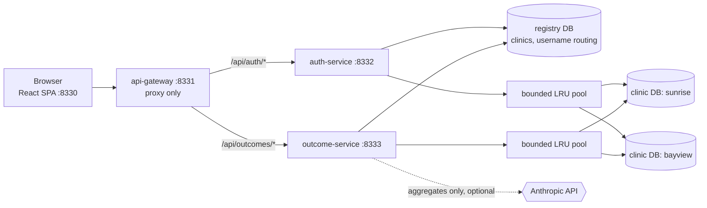
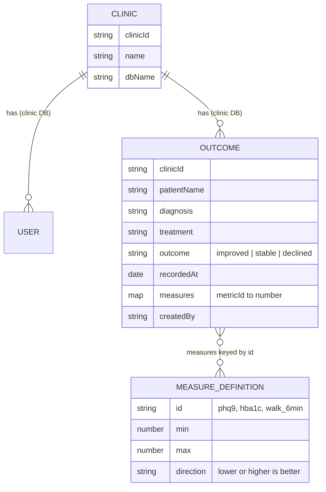
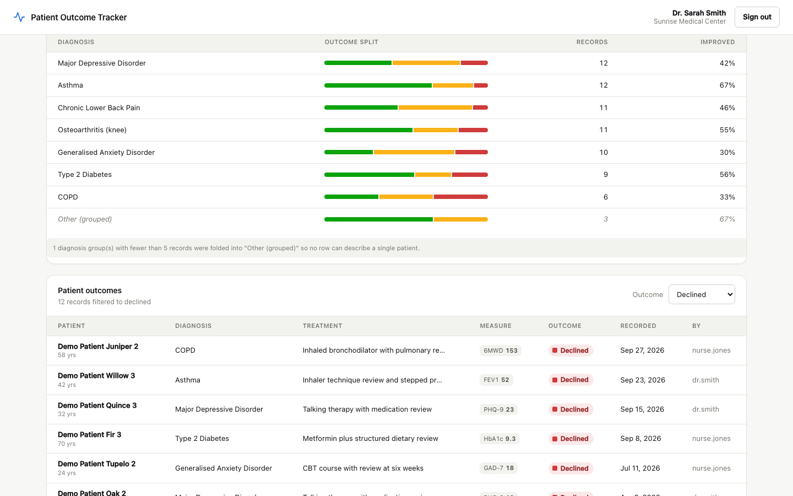

# Patient Outcome Tracker

A multi-tenant outcome tracker for clinics. Clinicians record whether a patient improved, stayed stable or
declined after treatment, along with numeric measures such as PHQ-9 or HbA1c, and read it back as monthly
trends, diagnosis cohorts and a plain-language summary. Each clinic's records live in a separate MongoDB
database, and the data layer refuses any query that does not name its clinic.


All data in the repo (seed scripts, fixtures, screenshots) is synthetic. Seeded patients are named
`Demo Patient <tree>`.

## Running locally

```bash
docker compose up --build        # then open http://localhost:8330
```

Compose starts MongoDB, runs the two seed jobs in order, then brings up the three services and the
nginx-served SPA. `docker compose down -v` removes the stack and its data. Every seeded account uses
`password123`:

| Clinic | Accounts | Seeded records |
| --- | --- | --- |
| Sunrise Medical Center | `dr.smith`, `nurse.jones` | 74 |
| Bayview Family Clinic | `dr.chen`, `admin.lee` | 61 |

Sign in as `dr.smith`, then as `dr.chen`: two different databases, two different dashboards.

Without Docker you need a MongoDB server and, for both backend services, `MONGODB_REGISTRY_URI`,
`MONGODB_BASE_URI` (server URI with no database name) and the same `JWT_SECRET`. The gateway needs
`AUTH_SERVICE_URL` and `OUTCOME_SERVICE_URL`. Then `npm run install:all`, `npm run seed`, and
one `npm run dev:<name>` per process: `gateway` (:4000), `auth` (:4001), `outcome` (:4002), `frontend` (:5173).

## Architecture



The registry holds the clinic list (each with its database name) and a `username -> clinicId` table, since a
username alone does not say which database holds the password hash. It stores no credentials and no patient
data. Each clinic database holds that clinic's users (bcrypt hashes) and outcome records. Inside each service,
routers call services, services call the tenancy, metric and AI modules, and only `src/config` reads
`process.env`. `src/container.js` is the single composition root, which is how tests build the same object
graph with a stubbed AI provider.



## Design decisions

**One database per clinic.** A shared collection with a `clinicId` column is cheaper to run; I chose physical
separation because a missing filter then cannot leak another clinic's rows, since they are not there. The cost
is real: one connection pool per clinic, schema changes that fan out N times and can half-succeed, and no
`GROUP BY clinic` for network-wide reporting. Nothing here does cross-clinic reporting, and adding it would
mean a fan-out-and-merge layer or a separate warehouse.

**Scoping lives in the model layer.** `outcome-service/src/tenancy/tenantScope.js` is a Mongoose
plugin bound to one clinic when the model is compiled. Reads, updates and deletes get `clinicId` injected;
aggregations get a `$match` prepended as stage zero; a filter, update or document naming a different clinic
throws (an empty result would hide the bug). `estimatedDocumentCount` and `bulkWrite` bypass query middleware,
so they are replaced with throwing stubs. The plugin cannot be applied without a clinic id, and the only
supplier is the connection pool, fed from the verified token. A token without a `clinicId` claim is a 401.
The service layer receives a frozen `tenantContext` pairing the clinic with its bound models, so code never
holds a model without its tenant. The auth side is weaker: users are reached only through a clinic-specific
connection, but there is no plugin behind it.

**A bounded connection cache.** At a thousand clinics, one open pool each would exhaust file descriptors or
MongoDB connection slots long before CPU. Both services cap the cache (`TENANT_MAX_CONNECTIONS`, default 50)
with LRU eviction and each pool at `TENANT_POOL_SIZE` (default 5), so sockets stay at or under 250 however many
clinics exist. Evicted pools close after a drain delay (`TENANT_EVICTION_DRAIN_MS`, 15s) so in-flight queries
finish. A failed handshake is not cached, so one network blip does not make a clinic unreachable until
restart. Registry lookups are cached for `CLINIC_CACHE_TTL_MS` (30s), negative answers included; the price is
that deactivating a clinic takes up to 30 seconds, and `0` buys instant revocation at one query per request.
The cost of the cap is a reconnect for any clinic outside the working set.

**Measures as configuration.** A new measure as a schema field would be a migration across every clinic
database. Instead a record stores `measures` as an open map, and `src/metrics/registry.js` decides which ids
are legal, their range and which direction is improvement (lower for five of the seven built-ins). An eighth
measure is an entry in `metrics/definitions.js` or in a JSON file at `METRIC_DEFINITIONS_PATH`. The entry form
and the dashboard read `GET /api/outcomes/metrics`, so the frontend needs no change. The trade-off is weaker
typing at the storage layer, which the registry's validation makes up for on write.

**A summary that never sees a patient.** `GET /api/outcomes/insights` writes from a briefing of counts, monthly
totals, cohort splits and measure means. `ai/briefing.js` throws if `patientName`, `notes`, `age`, `createdBy`
or `_id` appears anywhere in it, so widening the briefing fails loudly. Diagnosis groups under
`INSIGHT_MIN_GROUP_SIZE` (default 5) are folded into "Other (grouped)" first, because a cohort of one
identifies someone. The provider has two implementations: `computed` (local, no key) and `anthropic`. Any
failure of the second falls back to the first, and the response says which one answered. The response carries
the briefing itself, and the UI shows it behind a disclosure next to a decision-support disclaimer.




Errors follow the same rule: Mongoose validation errors embed the submitted document, so only `HttpError`
subclasses reach the client with their own message and everything else is a flat 500. Logs carry an error's
name and message, never the request body. The charts are hand-written SVG (React is the only runtime
dependency of the frontend), and outcome counts and measure means are drawn on separate plots so nobody reads
a correlation into a shared axis.

## API

All routes go through the gateway. Authenticated routes take `Authorization: Bearer <token>`; responses are
`{ success, message?, data?, errors? }`.

| Method | Path | Auth | Notes |
| --- | --- | --- | --- |
| `POST` | `/api/auth/login` | none | `{ username, password }` returns `{ token, user }`; 403 for a deactivated clinic |
| `GET` | `/api/auth/clinics` | none | Names and ids for the login screen, never database names |
| `GET` | `/api/auth/verify` | Bearer | Re-resolves the token's user and clinic |
| `GET` | `/api/outcomes` | Bearer | Newest first; `page`, `limit` (clamped to 100), `outcome` |
| `POST` | `/api/outcomes` | Bearer | `clinicId` and `createdBy` come from the token |
| `GET` | `/api/outcomes/stats` | Bearer | Count per outcome plus total |
| `GET` | `/api/outcomes/trends` | Bearer | Monthly counts and measure means; `months` default 12, max 60 |
| `GET` | `/api/outcomes/cohorts` | Bearer | Split by diagnosis with small-cell suppression |
| `GET` | `/api/outcomes/insights` | Bearer | Summary, its briefing, and the disclaimer |
| `GET` | `/api/outcomes/metrics` | Bearer | Measure registry: id, label, unit, range, direction |

Records are append-only: there is no update or delete route. Each service also exposes `GET /health`.

## Testing

```bash
npm run install:all
npm test            # 192 tests in 13 suites (auth 53, outcome 139)
npm run lint        # backend; npm run lint:frontend for the SPA
```

Jest and supertest drive each service's HTTP surface against a real MongoDB started in-process by
`mongodb-memory-server` (the first run downloads a binary). No MongoDB install, no `.env` and no network calls
to a model provider: the AI client is injected and the suites pass a stub. `tenantScope.test.js` checks that
an empty filter still returns one clinic's rows and that a filter naming another clinic throws;
`outcomes.access.test.js` covers the same ground end to end, including a token with no `clinicId` claim.
`connectionPool.test.js` runs in both services and covers eviction and failed handshakes.

## Limitations and roadmap

- Rate limiting on `POST /api/auth/login`, which is currently unthrottled.
- Refresh tokens and per-user revocation. Today only clinic deactivation revokes access.
- An audit log of record reads and writes, which real PHI handling requires.
- Role enforcement. Tokens carry a role, but every user in a clinic can read and write every record.
- Replication for the registry, which is a single point of failure.
- A frontend test suite (currently lint and a production build).
- Live coverage of the Anthropic path, which so far is tested only through the injected client.
- A shared package for the connection pool, duplicated across the two services.

This is not a certified medical device, and the summary is meant as decision support only.
